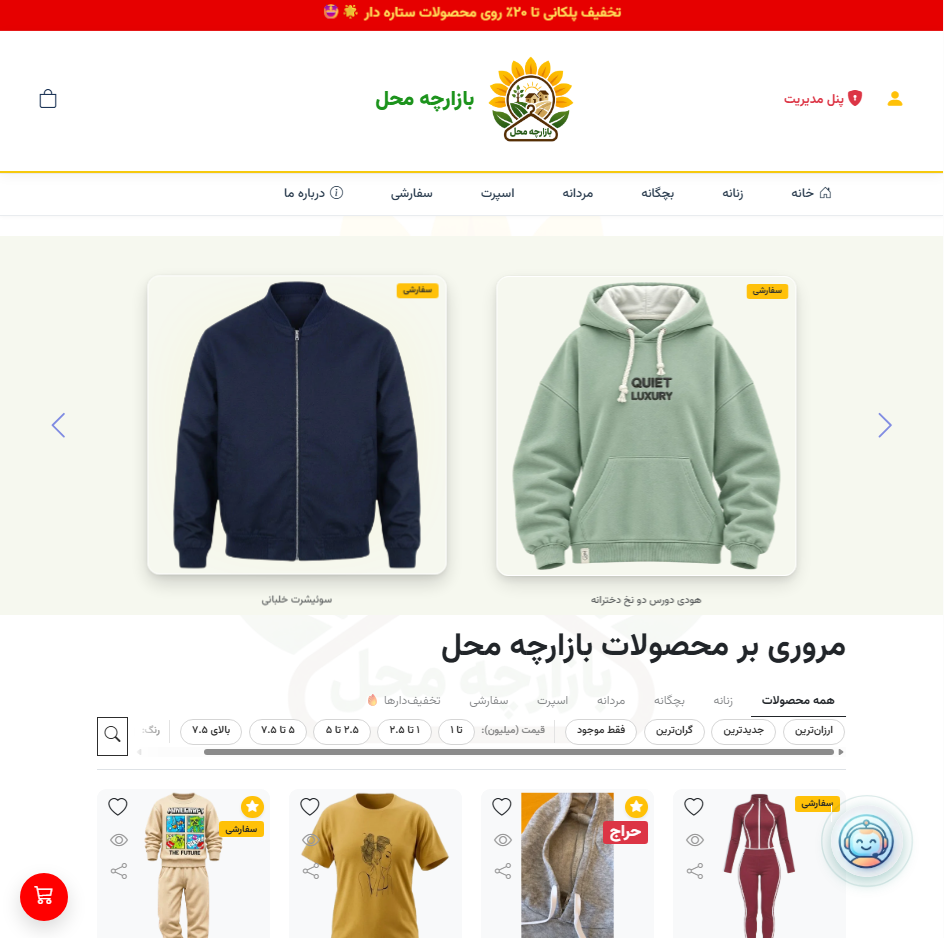
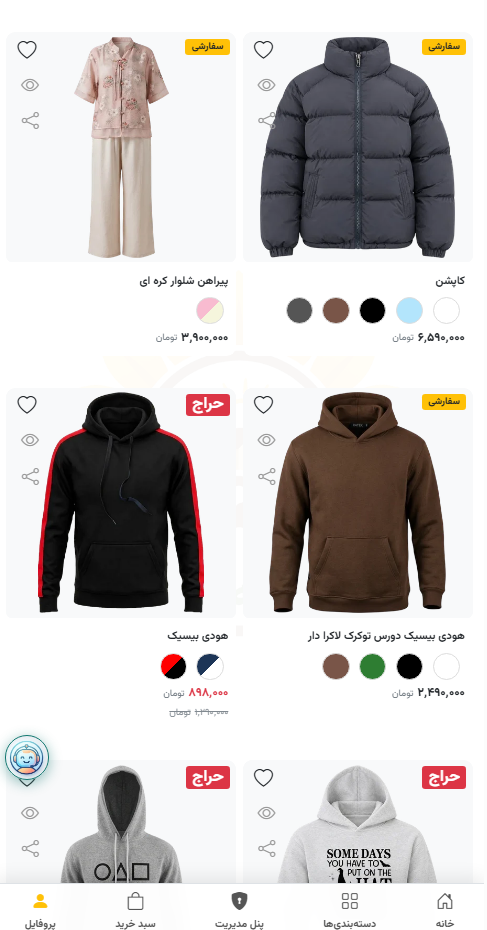
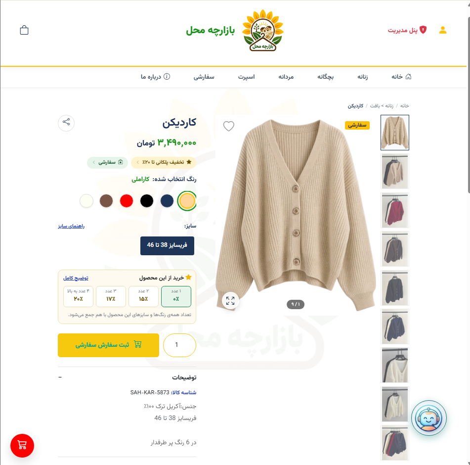
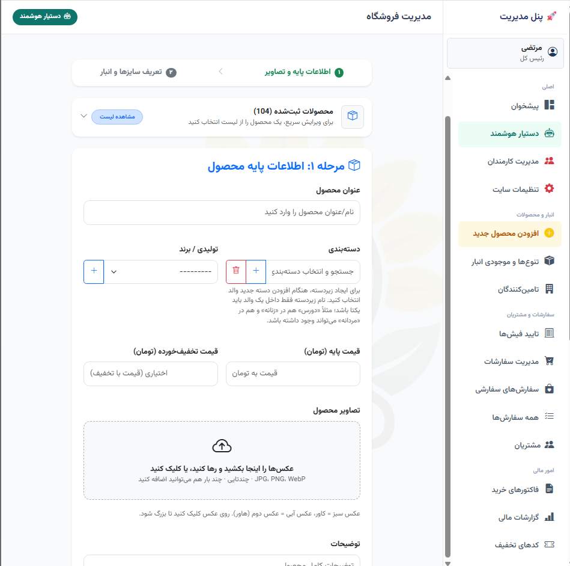
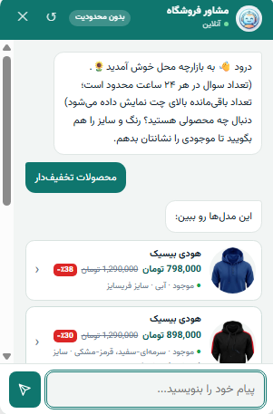
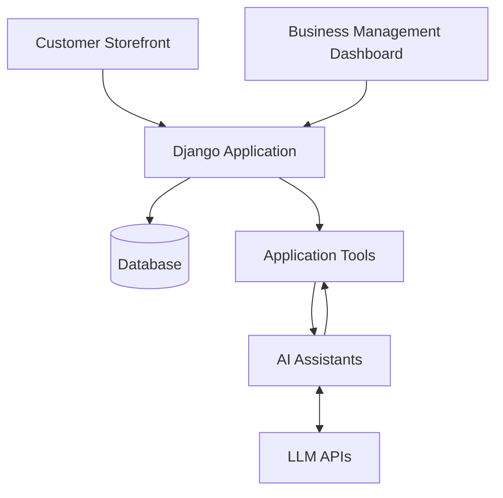

# 🛍️ Bazarche Mahal

### Full-Stack E-Commerce & Business Management Platform

**An independently developed platform combining online retail, business operations, and AI-powered assistants.**

[🌐 Live Website](https://bazarchemahal.ir)

---

## 📌 About the Project

Bazarche Mahal is a full-stack e-commerce and business management platform independently designed and developed by me.

The platform combines a customer-facing online store with an integrated business management system and AI-powered assistants.

I developed both the backend and frontend, covering application logic, database integration, user interfaces, AI integrations, and deployment.

## 🖥️ Application Preview

### 🏠 Online Store

### 📱 Product Catalog — Mobile View

### 👕 Product Details

### 📊 Business Management Dashboard

### 🤖 AI Customer Assistant

---

## 🧩 Main Components

### 🛒 1. E-Commerce Platform

- Product catalog and category management
- Product variations, colors, and sizes
- Shopping cart and order workflows
- Customer accounts and order tracking
- Wishlist and discount functionality

### 📊 2. Business Management System

- Product and inventory management
- Supplier management and purchase records
- Order and customer management
- Payment and receipt tracking
- Financial reports and business insights

### 🤖 3. AI Integration

The platform includes AI assistants integrated with application data and dedicated tools.

- Customer support assistant
- Product, price, stock, color, and size lookup
- Order information retrieval
- AI assistant for business management
- Tool calling for accessing application functionality
- LLM API integration

---

## 🏗️ High-Level System Architecture

The following diagram illustrates the main logical components of the platform.

## 🛠️ Technology Stack

| Area | Technologies |
|---|---|
| Backend | Python, Django |
| Frontend | JavaScript, HTML, CSS |
| Database | SQL |
| AI | LLM APIs, AI Agents, Tool Calling |
| Integrations | REST APIs |
| Infrastructure | Linux, VPS, Nginx |
| Version Control | Git, GitHub |

## 🔐 Project Availability

This repository serves as a public technical case study.

The original application source code, production configuration, credentials, and private business data are not included.

---

## 👨‍💻 Developer

**Morteza Mahdavi (MorT)**

Python Full-Stack Developer | AI & Machine Learning | AI Agents

**Built independently with Python, Django, and AI.**

